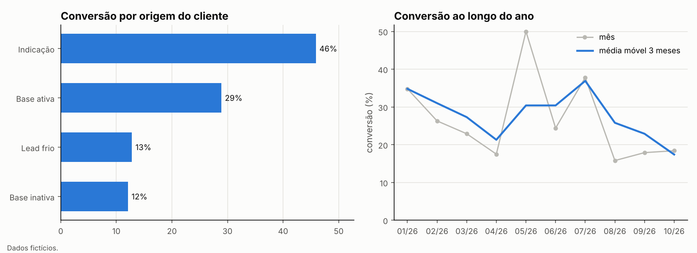
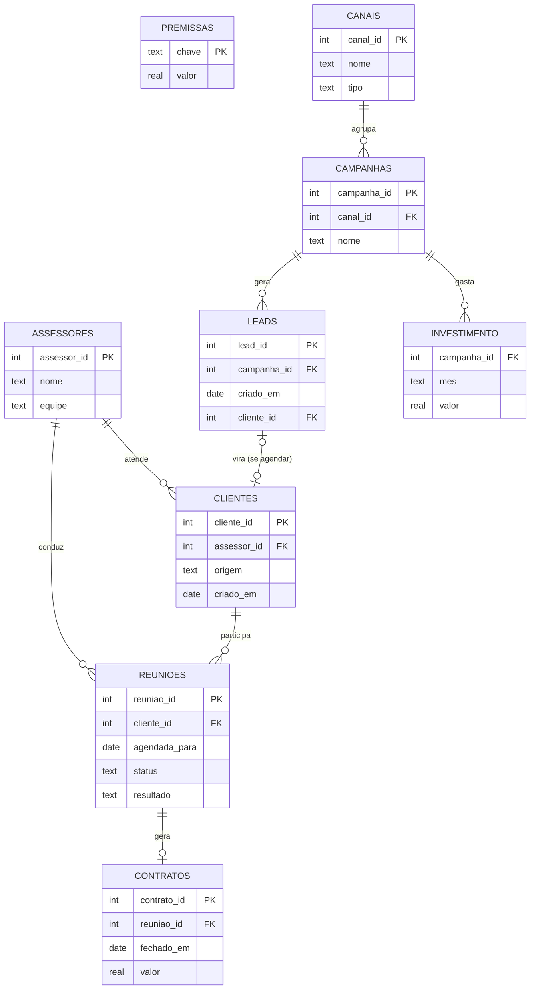

# Funil comercial de planejamento financeiro em SQL

Modelagem de dados e métricas de um funil comercial de **consultoria de planejamento financeiro**: do lead e do investimento em marketing ao contrato fechado, com conversão por origem do cliente, desempenho por assessor, custo de aquisição por canal, coortes e projeção de receita em cenários.

Este banco também é a fonte de dados do [estudo-cac-aquisicao](https://github.com/mlsantos92/estudo-cac-aquisicao), que compara o resultado com médias de mercado.

> **Todos os dados são fictícios.** Empresa, assessores, clientes, valores e taxas são gerados por código (`src/funil/gerar_dados.py`) com semente fixa. O projeto se inspira num problema real que conheço por trabalhar na área, mas não contém nenhuma informação de clientes ou empresas reais.



## Perguntas de negócio respondidas

| Pergunta | Consulta |
|---|---|
| Como evoluem agenda, comparecimento, conversão e receita mês a mês? | `funil_mensal` |
| Qual origem de cliente converte melhor e com que ticket? | `conversao_por_origem` |
| Quem são os assessores que mais faturam e quanto o faturamento é concentrado? | `ranking_assessores` |
| A diferença entre origens se mantém em cada equipe? | `conversao_por_equipe_e_origem` |
| A conversão está melhorando ou piorando? | `tendencia_conversao` (média móvel de 3 meses) |
| Quais negociações estão paradas há mais tempo? | `em_negociacao` |
| Quanto podemos faturar com as reuniões já agendadas? | `cenarios_proximos_meses` (pessimista, normal, otimista) |
| Quanto tempo um cliente leva para virar contrato? | `coorte_clientes` (30, 60 e 90 dias) |
| Quanto custa cada lead e cada cliente em cada campanha paga? | `funil_midia_paga` |
| Qual canal traz clientes mais baratos: mídia paga, indicação ou base? | `cac_por_canal` |

## Modelo de dados



A **camada de aquisição** (`canais`, `campanhas`, `investimento`, `leads`, `origem_canal`) liga o marketing ao funil: cada cliente de origem "lead" corresponde a um lead de mídia paga que agendou reunião, e cada lead que não agendou também está registrado, com o gasto mensal de cada campanha. Indicação e relacionamento com a base têm custo próprio (prêmios e horas de prospecção). Os dados dessa camada foram gerados para ficar **abaixo** das médias de mercado, simulando uma campanha paga que rendeu menos que o planejado.

As regras de negócio estão **no banco**, não só no código: `CHECK` garante que só reunião realizada tem resultado, `UNIQUE` impede dois contratos para a mesma reunião, chaves estrangeiras ligam tudo. Parâmetros como ticket, repasse e taxas dos cenários ficam na tabela `premissas`, e não espalhados pelas consultas.

## Organização do SQL

| Arquivo | Papel |
|---|---|
| `src/funil/sql/01_schema.sql` | tabelas, restrições e índices |
| `src/funil/sql/02_views.sql` | `vw_reunioes`: uma linha por reunião com cliente, assessor e contrato já unidos (camada intermediária, no estilo dbt) |
| `src/funil/sql/03_metricas.sql` | as 10 métricas de negócio, cada uma nomeada com `-- name:` |
| `src/funil/sql/04_qualidade.sql` | testes de qualidade: cada consulta deve voltar **vazia** (contrato sem reunião realizada, reunião antes do cadastro, status desatualizado, lead ligado ao cliente errado, mídia sem gasto registrado...) |
| `src/funil/sql/05_aquisicao.sql` | camada de aquisição e a visão `vw_leads` (cada lead com seu destino no funil) |

Técnicas usadas: `JOIN`/`LEFT JOIN`, CTEs (`WITH`), funções de janela (`RANK`, soma acumulada, média móvel com `WINDOW`), agregação condicional para tabela cruzada, `CROSS JOIN` para cenários, `NULLIF` contra divisão por zero, datas com `julianday`.

## Decisões de métrica

- **Conversão = contratos ÷ reuniões realizadas.** Quem faltou não teve chance de fechar; o no-show é medido à parte.
- **Coortes:** cliente sem contrato conta como 0, e uma janela que ainda não terminou para a coorte inteira fica em branco. Uma versão anterior da consulta tinha um erro clássico (o `AVG` ignorava os `NULL` dos clientes que não fecharam e mostrava quase 100%); o teste automatizado agora protege contra isso.
- **CAC = investimento do canal ÷ contratos daquela origem.** Indicação e base também custam dinheiro; tratá-las como "grátis" faria a mídia paga parecer pior do que é em termos relativos.
- **Meses recentes amadurecem:** a conversão de outubro e novembro ainda vai subir, porque parte das reuniões está em negociação.

## Como rodar

```bash
git clone https://github.com/mlsantos92/funil-planejamento-sql
cd funil-planejamento-sql
pip install -r requirements.txt && pip install -e .
# ou, para usar como biblioteca em outro projeto:
# pip install git+https://github.com/mlsantos92/funil-planejamento-sql

python -m funil.relatorio   # gera o banco data/funil.db, roda testes de qualidade e métricas, grava outputs/
pytest                      # testes
sqlite3 data/funil.db       # para explorar as tabelas à mão
```

## Sobre o uso de IA

Desenvolvido com IA como copiloto de código. O modelo de dados, as perguntas de negócio, as definições de cada métrica e os testes de qualidade vêm da minha experiência com funis comerciais de planejamento financeiro.
